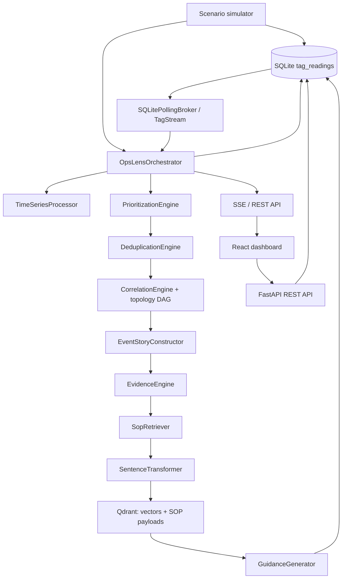

# OpsLens: Full Project Walkthrough

This guide describes the code currently in this repository. It is intended as a study guide and interview reference. It separates what the code actually does from the broader design goals in the README and from items that are not yet connected.

## 1. One-minute explanation

OpsLens is an edge-oriented operator-support prototype. It accepts industrial tag readings, detects readings outside configured ranges or explicit trip thresholds, groups related breaches into an incident, looks for related signals in a time window and a tag-topology graph, creates a human-readable event sequence, ranks likely contributing signals with a transparent heuristic, retrieves relevant SOP text with SentenceTransformer embeddings and Qdrant, and presents the result in a React dashboard. SQLite stores readings and incident records. Operator actions are audit records. The simulator supplies demo data. The code has OPC UA, MQTT, and REST adapter classes, but the normal server path does not yet start those adapters or connect to a real PLC. The system is advisory and must not be described as a controller.

**Current demo flow:** synthetic scenario → FastAPI → deterministic detection/correlation/evidence → Qdrant SOP retrieval → deterministic SOP-based guidance or fallback/optional model → React dashboard.

## 2. What exists today, and what it is not

| Area | Current repository behavior |
|---|---|
| Backend | FastAPI REST API and SSE stream, started by `edge_intelligence/server.py` on port 8000. |
| Frontend | React 18 SPA served by Vite on port 5173. It opens directly to the operations dashboard; there is no login or route-based multi-screen shell. |
| Demo data | A synthetic generator writes readings to SQLite and can run seven scenario classes. |
| Live industrial data | Adapter classes exist, but they are not wired into the default FastAPI startup/pipeline. `/api/integration/status` reports that they are not connected. |
| Storage | SQLite stores telemetry and incident workflow data. Qdrant stores SOP vectors and chunk payloads. |
| RAG | SentenceTransformer `all-MiniLM-L6-v2` creates 384-dimensional vectors. Qdrant is primary; BM25 is a fallback. |
| LLM | Optional. A sufficiently relevant Qdrant SOP takes the deterministic SOP-guidance path. When there is no valid SOP, optional cloud/local model calls are attempted, then deterministic fallback. |
| Industrial writes | There is no implemented PLC/actuator write path. Adapter interfaces are read-only; operator buttons create audit/workflow records. |
| EcoStruxure EOTE | The React dashboard is not automatically embedded in EOTE, and EOTE is not wired to this backend by the current code. It requires a configured web/browser integration or a separate data bridge. |

Use “prototype,” “demo,” or “edge-oriented implementation” when describing it. Do not claim validated root-cause prediction, approved plant procedures, live PLC connectivity, production cybersecurity, or certified safety behavior.

## 3. Repository map: which folders matter

The **primary active code** is:

```text
OpsLens-main/
├── edge_intelligence/       Python backend and intelligence pipeline
├── hmi_ui/                  React/Vite operator dashboard
├── docker-compose.yml       Optional local Qdrant server
├── README.md                High-level setup/architecture notes
└── PROJECT_WALKTHROUGH.md   This detailed study guide
```

The root also contains `ops-lens/` and `opslens-generator/`. These are separate/alternate or older copies with overlapping code. The root README identifies `edge_intelligence/` and `hmi_ui/` as the active architecture. When explaining or editing the live project, verify that you are in those folders. Do not assume a similarly named file in one of the other trees is the one the running backend imports.

Generated/local runtime items include `edge_intelligence/.venv/`, `hmi_ui/node_modules/`, `edge_intelligence/opslens.db` (plus SQLite WAL files), and `edge_intelligence/qdrant_data/`. They are runtime/dependency data, not source modules.

## 4. Tech stack and why it is used

### Python 3 + FastAPI + Uvicorn

- **Python** is used for the data-processing and ML ecosystem, scenario logic, integrations, and backend orchestration.
- **FastAPI** defines HTTP endpoints with Python decorators such as `@app.get(...)` and `@router.post(...)`. Pydantic request models validate JSON input, and FastAPI produces interactive OpenAPI docs at `/docs`.
- **Uvicorn** is the ASGI server that runs the asynchronous FastAPI application. FastAPI is the application; Uvicorn is the network process serving it.
- **Why not Flask?** Flask can serve the same REST functions, but this application uses async tasks, SSE/WebSockets, request models, and generated OpenAPI docs; FastAPI makes those patterns direct. Flask is still viable for simpler synchronous APIs.

### Pydantic

Pydantic `BaseModel` classes in `models.py` define shared data contracts such as `TagReading`, `CandidateEvent`, and `Evidence`. Type annotations describe fields; `Field(ge=0, le=1)` adds bounds; `Literal[...]` restricts allowed strings; `default_factory` creates a new list/UUID for each instance. `model_dump()` converts a model to a Python dictionary suitable for JSON serialization.

### SQLite

SQLite is an embedded relational database stored in a local file. It avoids requiring a separate database server and is a good fit for a single edge PC and a modest local prototype. The database uses WAL (write-ahead logging), indexes on common lookups, parameterized SQL, and JSON serialization for nested records.

SQLite is not a time-series database: it works here because the prototype has small/simple workloads and needs local durability. A high-ingest, multi-writer deployment may need a dedicated time-series store or a broker and a larger operational database.

### Qdrant + SentenceTransformers + BM25

- **SentenceTransformers** runs `all-MiniLM-L6-v2` locally and maps text to a 384-number embedding vector. Similar meanings tend to have nearby vectors.
- **Qdrant** stores vectors and JSON payloads and executes nearest-neighbor search. It can run as a local server (Docker/native) or in the Python process using persistent embedded storage.
- **Cosine similarity** is the configured distance. Qdrant's returned score is a vector-similarity score; it is not a probability or calibrated confidence.
- **BM25** is a keyword-ranking fallback if semantic retrieval fails. Its score is a keyword score and must not be mislabeled as Qdrant semantic similarity.
- **Why not NumPy as primary storage?** A local NumPy array requires custom indexing, metadata filtering, persistence, and concurrency handling. Qdrant supplies a vector database interface and payload filtering while keeping deployment local.
- **Why not a cloud vector service?** This project targets edge operation and must not require cloud connectivity. Qdrant is local-first here.

### React 18 + Vite + Tailwind CSS + Lucide

- **React** creates reusable UI components and manages changing display state.
- **Vite** serves the frontend during development and bundles it for production.
- **Tailwind CSS** uses utility classes in JSX for spacing, color, layout, and typography, avoiding a large custom stylesheet for each component.
- **Lucide React** supplies SVG icons as React components.
- The UI uses `fetch()` for JSON REST calls and the browser's `EventSource` API for Server-Sent Events (SSE).

### NetworkX

NetworkX provides a directed graph implementation for the prototype equipment relationship context. If it is unavailable, `knowledge_graph.py` degrades to no graph context. Separately, `topology.py` implements tag-DAG traversal directly using Python adjacency lists and breadth-first search; the core correlator uses that topology graph.

### Optional language models

Cloud providers are accessed via REST if configured API keys and network access are available. A local Ollama/OpenAI-compatible endpoint can be used without cloud. An in-process Transformers model is also sketched but is not included in the base requirements. None is needed for the normal valid-SOP deterministic path, and no API key is mandatory to run the local demo.

## 5. Architecture and data flow



### What happens when a demo scenario runs

1. The React header calls `POST /api/scenarios/run` with a scenario ID and speed multiplier.
2. FastAPI creates a `SyntheticDataGenerator`, which uses the tag registry and selected scenario state machine.
3. At each sample, the generator first creates baseline noise, then applies scenario overrides, builds `TagReading` Pydantic objects, writes each reading to SQLite, and yields the readings.
4. The route calls `orch.process_reading(reading)` for yielded readings. Separately, the server's startup task consumes the SQLite polling stream. This means the current simulator path has both a direct processing path and a DB-poller path; deduplication is intended to reduce repeated/clustered alert noise. It is an implementation detail to know and a place to simplify before production.
5. `TimeSeriesProcessor` updates bounded per-tag history. `DeduplicationEngine` asks `PrioritizationEngine` whether the reading is a breach and either updates a cluster or creates a UUID event.
6. The orchestrator starts an async worker for each candidate event. It creates equipment, telemetry, observation, and graph context; calls correlation; constructs the event story; computes evidence; synthesizes alarm context; retrieves SOP chunks; creates guidance; and persists each stage.
7. After the joined event is available, the orchestrator broadcasts it to subscribers' queues. The FastAPI SSE endpoint converts each event dictionary to `data: <JSON>\n\n`.
8. React receives the event and fetches the full event through REST, then updates state. The UI animates the story sequence unless “Instant” pacing is selected.
9. When an operator presses Verify, Inspect, or Resolve, the UI posts an audit action. This records workflow metadata; it does not write to a PLC.

## 6. Data contracts and core algorithms

### `TagReading`

An individual observation: `tag`, `value`, `timestamp`, `unit`, and `equipment_id`, with optional `alarm_state`. `value` permits float, bool, or string to support analog and discrete tags. Times are intended to be ISO-8601 UTC; `current_iso_utc()` appends `Z` after formatting UTC.

### `TagRegistryEntry`

The metadata for a known tag: equipment, unit, data type, operating baseline bounds, optional trip threshold, severity weight (0–1), upstream tag dependencies, and a human label. It centralizes tag-specific configuration, allowing engines to avoid scattering thresholds through code.

The current registry contains **11 tags** across Pump-02, Compressor-01, and Tank-01. Pump-02's demonstration tags include valve position, flow, motor current, pressure, and a high-pressure alarm. The configured thresholds/baselines are demo configuration and must be checked against an actual plant's engineering data before any real operational use.

### Prioritization formula

For a float tag, the configured midpoint is:

```text
midpoint = (baseline_min + baseline_max) / 2
deviation_pct = ((reading - midpoint) / midpoint) * 100
scaled_tolerance = 12 * (1.2 - 0.4 * severity_weight)
```

A breach is either an explicit directional trip threshold or a value outside the configured baseline range whose absolute deviation exceeds the severity-scaled tolerance. A `True` boolean alarm is a trip. This is deterministic rule logic, not a trained anomaly detector. It calculates deviation from a configured midpoint rather than learning a statistical plant baseline.

### Deduplication and candidate events

`DeduplicationEngine` groups breaches by same equipment or topology-linked tags when they fall inside its default 90-second cluster window. The primary tag is selected using this order: explicit trip alarm first, then tag severity weight, then magnitude of deviation. The resulting `CandidateEvent` includes event UUID, primary tag, alarm flag, trigger time, raw deviation, and clustered tags.

### Correlation and temporal ordering

`CorrelationEngine` queries SQLite-backed `TagStream.get_window()` for readings around the trigger (default lookback 120 seconds), checks tags from the equipment and reachable upstream topology, finds excursions outside registry bounds, ignores deviations below the 5% noise threshold and graph distances over 3, and sorts retained deviations by first excursion time. It records whether each onset preceded the primary trigger. This is heuristic temporal/topological correlation, not proof of physical causality.

The topology is a directed acyclic graph encoded by `topology_upstream` in the tag registry. An edge from upstream tag to downstream tag means the downstream signal is modeled as depending on the upstream tag. The custom `TopologyGraph` uses BFS to compute hop distance and also permits same-equipment undirected paths for sibling signals.

### Event story

`EventStoryConstructor` formats correlated deviations into ordered `EventStoryStep` objects. It uses registry `short_label` values and a signed percentage to make descriptions, then joins labels with arrows into `causal_label`. It does not establish causality; it renders the earlier correlation output as an operator-readable hypothesis. `value_before` is based on the configured midpoint and `value_after` is reconstructed from the deviation percentage, not read as an exact raw pair in this constructor.

### Evidence Engine

For each correlated non-primary tag, `EvidenceEngine` computes:

```text
score = (abs(deviation_pct) / 100)
        * severity_weight
        * (1 / (topology_distance + 1))
        * (1.2 if precedes_primary else 0.8)
```

It chooses the tag with the largest score as `likely_contributor_tag`. It also calculates `confidence_score = top_score / sum(all_scores)` and labels the ratio HIGH/MEDIUM/LOW. That ratio is a **normalized dominance heuristic**, not a statistically calibrated probability that the tag caused the event. Always explain the factors and the limitation. It persists both its output and a per-tag calculation breakdown.

This evidence `confidence_score` is a different field from RAG `semantic_similarity`. Qdrant semantic similarity measures closeness between two text embeddings. Neither one should be presented as a validated root-cause probability.

### Time-series processor and graph context: implementation boundary

`TimeSeriesProcessor` keeps up to 120 readings per tag in memory and calculates recent mean, deviation, direction of the last change, per-sample change, threshold crossing, and a simple three-standard-deviation change-point flag after five prior numeric values. The field called `rate_of_change` is the raw difference between adjacent samples, not divided by elapsed seconds. History is keyed by tag (not `(equipment, tag)`) and is cleared only when the process restarts; `/api/demo/reset` does not reset this processor.

The time-series observations and NetworkX context are passed into correlation/evidence/RAG context, but prioritization still uses registry baseline/trip configuration. `IndustrialKnowledgeGraph` is a small static Pump-02 prototype graph; it does not yet model all seven scenarios or dynamically ingest an asset graph.

## 7. RAG and SOP details

### Source documents and chunking

The canonical source documents are JSON files in `edge_intelligence/sop_documents/`. The active folder currently contains four sample documents: `bearing_wear.json`, `seal_leak.json`, `sensor_fault.json`, and `valve_restriction.json`. Each is expected to contain a SOP ID/title, equipment, optional metadata, and a `steps` list.

`ingest_sops.py` creates a header/overview chunk, one chunk per step, and one aggregate procedure chunk. It preserves the instruction text in payload fields and uses deterministic UUID5 chunk IDs. It encodes each chunk with `SentenceTransformer("all-MiniLM-L6-v2", local_files_only=True)` and upserts points into `opslens_sops`. The generated vector is 384 dimensions. You must download/cache the model before running offline; local-only loading intentionally does not fetch it from the internet.

Payload includes SOP/document IDs, document name, title, equipment/type, area, revision, effective date, source, keywords, reference limits, tags, section, page, chunk ID, text, and step instruction where applicable. The JSON source stays on disk; Qdrant payloads also carry retrievable chunk text. `sop_index.json` is a text-only manifest used by the BM25 fallback, not the primary vector store.

### VectorStore abstraction

`vector_store/base.py` defines the generic contract and data-transfer objects:

- `VectorStoreDocument`: a chunk ID, document/SOP IDs, text, embedding, and payload.
- `VectorSearchResult`: one hit and a `to_dict()` serializer.
- `VectorStore`: abstract methods for add/upsert, search, get document, delete, delete by document ID, health, and count.

`QdrantVectorStore` implements the contract. The RAG pipeline depends on this interface/adapter boundary rather than Qdrant internals, which makes another vector backend possible later.

### Qdrant schema, local operation, and score

- Collection default: `opslens_sops` (`QDRANT_COLLECTION`).
- URL default: `http://localhost:6333` (`QDRANT_URL`) for a local Qdrant server.
- Persistent embedded option: `QDRANT_URL=embedded`; data path comes from `QDRANT_PATH` (default `./qdrant_data`, relative to process working directory).
- Vector size: 384; distance: cosine.
- Payload keyword indexes: `sop_id`, `document_id`, `equipment`, `equipment_type`, and `plant_area`.
- Upsert IDs are deterministic UUID5-derived IDs so re-ingestion updates the same points rather than duplicating them.

`docker-compose.yml` starts only the Qdrant server and persists its database in a Docker volume. It does not start the FastAPI backend or React dashboard. For local development, the last verified demo configuration used embedded Qdrant inside the backend, so port 6333 was not required. In a multi-process deployment, a Qdrant server is usually the clearer shared service.

**Filtering caveat:** the Qdrant code constructs equipment aliases in a `should` filter and plant area in `must`, then retries without a filter only if the first query returns no hits. The code comments call this a soft preference, but Qdrant filter conditions are filters, not a vector score boost. If matching equipment points are returned, other equipment results may not be considered. This should be reviewed if cross-equipment SOPs must always remain eligible.

### Contextual query and retrieval

`SopRetriever.build_contextual_query()` composes text from available equipment, alarm/primary tag, event-story labels, symptom descriptions, supporting deltas, likely contributor, current telemetry, time-series observations, and graph relationships. It embeds the entire context, not only one tag ID.

The retriever asks Qdrant for top-K chunks (default 5), groups candidates by SOP ID to determine the best SOP by its highest chunk score, retains top-K chunk details, and stores `why_retrieved` and an in-memory/debug trace. It retrieves the full SOP document from Qdrant payloads to supply its steps to the guidance generator. The raw Qdrant cosine score is returned as `semantic_similarity` and surfaced in the UI as “Semantic relevance.”

If embedding/Qdrant retrieval raises an error or returns no chunks, code falls back to BM25 over JSON SOP documents. In that case `retrieval_method` becomes `bm25`; BM25's number is a keyword score, and `semantic_similarity` is `None`. Do not call this score a cosine similarity.

### Full procedure viewer

The React SOP modal calls `GET /api/sops/{sop_id}` when opened. FastAPI retrieves payload chunks from Qdrant and reconstructs the document/steps. React does not contain a hardcoded list of procedure steps. The modal shows revision/source context, “why retrieved” fields, and display-only step verification checkboxes (the checkbox state is currently held in React state; it is not persisted as an operator audit action).

### Current RAG limitations worth disclosing

- `get_document()` scrolls at most 200 chunks at once and uses the returned chunk payloads to reconstruct a SOP; extremely large SOPs need pagination.
- `/api/rag/health` constructs a fresh store object per request rather than querying a single managed store instance.
- Filtering behavior should be reviewed as described above.
- BM25 and Qdrant scores are different units and methods.
- The local embedding model must already be cached for disconnected operation.
- The sample SOP JSON is prototype content. Do not present it as an approved site operating procedure without review by the responsible process/safety authority.

## 8. Guidance / LLM behavior

`GuidanceGenerator` first checks in-memory and SQLite caches. It then checks whether the retrieved SOP is usable: valid SOP ID, non-empty steps, Qdrant method, and semantic score at least 0.25.

- **If a SOP qualifies:** code calls `generate_sop_guidance()` directly. It selects up to three procedure steps and forms a deterministic explanation. The normal valid-SOP path does not call a cloud LLM and does not require an API key.
- **If there is no sufficiently relevant SOP:** it builds a structured prompt from story, evidence, SOP/context, and retrieved chunks. If cloud keys are configured and connectivity is available, it tries Gemini, OpenAI, or Anthropic (in that order). If not, it tries a local Ollama-compatible service. In-process Transformers inference is only attempted when `EDGE_LLM_PROVIDER` is configured and optional dependencies/model are installed.
- **If model output fails:** it attempts deterministic SOP fallback if a SOP qualifies; otherwise it returns the exact fallback text “Operator verification required.”

The prompt tells the model to use only supplied facts, preserve numeric values, not invent procedure/limits/equipment state/control action, and return JSON. The code parses that JSON and checks numeric tokens plus whether suggested actions appear as exact substrings in SOP step text. These checks reduce risk but do not mathematically guarantee that all nonnumeric claims are true. The current deterministic SOP fallback also pads fewer-than-three-step procedures with generic text; this should be revisited before safety-critical use.

The honest interview answer is: **“An LLM API key is optional. For an adequate local SOP match, current code uses deterministic SOP-based guidance. For no/low SOP match, it can use configured cloud or local models and falls back deterministically when unavailable. This is advisory and not a certified safety layer.”**

## 9. SQLite tables and persistence

`database.py` creates the local `opslens.db` database and uses `check_same_thread=False` for its shared connection, WAL mode for reader/writer coexistence, and parameterized SQL for values. The main tables are:

| Table | Stores |
|---|---|
| `tag_readings` | Raw typed telemetry values plus raw representation, UTC timestamp, unit, and equipment ID. |
| `candidate_events` | Initial prioritized/deduplicated event and clustered tags. |
| `correlated_events` | Candidate fields plus correlated deviations and context. |
| `event_stories` | Ordered serialized story steps and causal label. |
| `evidence` | Contributor, normalized score/label, deltas, and full scoring breakdown JSON. |
| `sop_matches` | SOP identity, backward-compatible match score, semantic similarity, query, retrieved chunks, rationale, and RAG trace. |
| `guidance` | Explanation, action list, cited SOP, and generation source. |
| `operator_actions` | Action UUID, event, operator, workflow action, timestamp, and notes. |

Nested lists/dictionaries are stored as JSON text in SQLite and rehydrated into Pydantic models on reads. The database applies additive schema migration for newer RAG columns in `sop_matches`.

## 10. API reference

FastAPI routes are declared in `edge_intelligence/api/routes.py`; visit `http://localhost:8000/docs` when the backend is running.

| Method and path | Purpose |
|---|---|
| `GET /` | Backend welcome/status document with links to dashboard/docs. |
| `GET /api/events/open` | List open event identifiers. |
| `GET /api/events/{event_id}` | Joined candidate, correlated event, story, evidence, SOP, guidance, and operator actions. |
| `GET /api/events/stream` | SSE stream of completed events; emits ping and keepalive comments. |
| `WS /api/events/ws` | WebSocket alternative event stream. |
| `POST /api/actions` | Validate and save an operator workflow action. Not a PLC command. |
| `POST /api/handover` | Compile shift summary from `shift_start` and `shift_end`. |
| `GET /api/handover` | Same handover using ISO timestamps as query parameters. |
| `GET /api/scenarios` | List simulator scenarios. |
| `POST /api/scenarios/run` | Start a scenario asynchronously; returns immediately with “started.” |
| `POST /api/demo/reset` | Clears demo telemetry, event, guidance, SOP-match, and action records and in-memory dedup/orchestrator sets. It is a demo reset, not a plant reset. |
| `GET /api/status` | Online flag, open events, and configured registry baseline ranges. |
| `GET /api/health` | Basic component labels. These values are mostly descriptive/hardcoded, not deep probes. |
| `GET /api/rag/health` | Actual Qdrant collection/client check, chunk/document counts, embedding model and method. |
| `GET /api/sops/{sop_id}` | Full SOP reconstructed from Qdrant chunk payloads. |
| `GET /api/debug/rag/{incident_id}` | Query context and top-K retrieval trace; trace can be rebuilt from SQLite after restart. |
| `GET /api/debug/intelligence/{incident_id}` | Joined trace through detection, correlation, story, evidence, RAG, guidance, and actions. |
| `GET /api/integration/status` | Static configured adapter statuses and read-only notes; does not prove a live connection. |

**HTTP vocabulary:** `GET` reads; `POST` submits or triggers an operation. A Pydantic model such as `ScenarioRunRequest` validates the JSON body. `HTTPException(404, ...)` returns a structured HTTP error. Query parameters use `Query(...)`. A route function declared `async def` can await async work. The scenario route creates an `asyncio` task so the HTTP response returns without waiting for the whole scenario.

**SSE vocabulary:** the server holds an `asyncio.Queue` per subscriber. Completed events are JSON encoded and sent as `data: ...` records separated by blank lines. The browser's `EventSource` reconnects automatically; the frontend calls `.close()` on cleanup.

## 11. Frontend: files, state, and syntax

### Browser startup and API client

- `hmi_ui/index.html` provides the root DOM element.
- `src/main.jsx` uses `ReactDOM.createRoot(...)` to mount `<App />` under `<React.StrictMode>` and loads global CSS.
- `vite.config.js` enables the React plugin, serves port 5173, and proxies `/api` to port 8000. `src/api/client.js` defaults to `http://localhost:8000/api` and can be changed with `VITE_API_BASE_URL`.
- `client.js` centralizes `fetch()` requests, checks `response.ok`, parses JSON, and wraps API operations in exported `async` functions. `subscribeToEventStream()` wraps `EventSource` and returns an unsubscribe function.

### `App.jsx`

`App` is the root React function component and state owner. `useState` stores event data, scenario selection, animation state, current pacing mode, modal visibility, and operator feedback. `useEffect` initializes scenarios/handover/open events and subscribes to SSE; its cleanup closes timers and the stream. `useCallback` memoizes functions used by the effect. `useRef` stores timer IDs without triggering rerenders.

The `<Header ... />`, `<AlarmPrioritization ... />`, etc. are child components. Values between `{}` are JavaScript expressions. JSX `onClick={...}` passes an event callback. `fullEvent?.story?.steps` uses optional chaining so missing nested data does not crash rendering. `||` supplies a fallback; `??` supplies a fallback only for `null`/`undefined` (important when zero is a valid score). The `map()` calls create repeated cards; each child has a `key` so React can reconcile list items.

`App.jsx` currently renders a single dashboard composition. There is no React Router or standalone history/equipment/status page in this active frontend. The SOP and handover experiences are modal overlays.

### Component responsibility table

| File | Role |
|---|---|
| `Header.jsx` | Logo, current system/alarm status, scenario selector, animated/instant pacing, start/reset controls, alarm details popover. Operator name is currently a fixed demo string. |
| `AlarmPrioritization.jsx` | Current alarm/severity presentation and event summary. |
| `ProcessValues.jsx` | Four process cards derived from event-story steps; nominal values are hard-coded fallback display data when no incident exists. **The normal state cards are not a live telemetry feed.** |
| `EventStory.jsx` | Displays the causal/event sequence and reveals steps according to animation progress. |
| `EvidenceSection.jsx` | Contributor tag, heuristic HIGH/MEDIUM/LOW label and supporting deviations. The UI currently expresses the evidence dominance ratio as a percent-like display. It is not a calibrated probability. |
| `RelevantSop.jsx` | SOP ID/title, Qdrant semantic relevance score, and button to open full procedure. |
| `SopModal.jsx` | Fetches full SOP dynamically; displays metadata, retrieval rationale, and locally checked step boxes. Checkbox state is not persisted. |
| `NextBestAction.jsx` | Shows guidance plus Verify/Inspect/View SOP/Resolve workflow buttons. Verify/Inspect/Resolve submit audit records only. |
| `ShiftHandoverCard.jsx` | Shift summary on dashboard and button to open ledger. |
| `HandoverModal.jsx` | Expanded handover ledger and event/action details. |
| `index.css` | Global fonts, base styling, and custom styles. |
| `tailwind.config.js` | Design tokens, font families, and file globs for Tailwind class scanning. |
| `public/opslens-logo.png` | Public logo image loaded by the header. |
| `public/ecostruxure-opslens-panel.svg` | Static panel/reference asset; not a live EOTE data connection. |

The dashboard's normal-state card values are explicitly fallback constants. During an incident, `ProcessValues` reconstructs values from story step `value_before` / `value_after`, which themselves use the story model described above. So explain this as a visual demo behavior, not a high-frequency live telemetry visualization.

## 12. Backend file-by-file map

| File | Responsibility |
|---|---|
| `server.py` | Creates Database, TagStream, Orchestrator; starts stream consumer in FastAPI lifespan; runs Uvicorn on `0.0.0.0:8000`. |
| `api/routes.py` | REST, SSE, WebSocket, simulator, SOP, RAG health/debug, integration status endpoints and request schemas. |
| `orchestrator.py` | Owns engines; consumes readings; fans out async incident tasks; runs stages in sequence; joins persisted outputs; broadcasts results. |
| `models.py` | Pydantic schemas and UTC helpers shared across the backend. |
| `database.py` | SQLite connection, WAL, schema/indexes, write/read methods, migrations, JSON encoding. |
| `stream.py` | `IStreamBroker`, SQLite polling pub-sub implementation, async `TagStream` subscription and time-window query. |
| `generator.py` | Baseline Ornstein-Uhlenbeck noise, reading creation, SQLite persistence, sync/async scenario stream. |
| `scenarios/base.py` | Abstract scenario state machine contract and smooth interpolation helper. |
| `scenarios/*.py` | Seven incident archetypes: valve restriction, bearing wear, seal leak, sensor fault, tank overflow, compressor overspeed, pump cavitation. |
| `scenarios/__init__.py` | Scenario-name/alias registry and factory/listing functions. |
| `tag_registry.py` | Eleven tag definitions, nominal ranges, thresholds, weights, labels, upstream links, graph helpers. |
| `registry_loader.py` | Read-only abstraction around registry lookups. |
| `prioritizer.py` | Threshold and baseline deviation checks. |
| `dedup.py` | Time-window/topology cluster manager and primary tag election. |
| `topology.py` | Builds/traverses directed tag DAG; BFS distances. |
| `time_series.py` | In-memory bounded histories and simple sample-to-sample observations. |
| `knowledge_graph.py` | Small optional NetworkX asset relationship graph and context strings. |
| `correlator.py` | Queries time window; filters by excursion and topology; builds correlated event. |
| `event_story.py` | Turns correlated deviations into timestamp-sorted story steps and a causal label. |
| `alarm_synthesis.py` | Bundles candidate/story/telemetry observations into a compact synthesized-alarm dictionary for RAG. |
| `evidence_engine.py` | Transparent formula, supporting deltas, normalized contribution dominance and audit breakdown. |
| `vector_store/base.py` | Generic vector store interface and transfer/result objects. |
| `vector_store/qdrant_store.py` | Qdrant client, collection creation, upsert, filtered top-K search, SOP reconstruction, delete, health/count. |
| `sop_documents/*.json` | Four sample SOP source documents. |
| `ingest_sops.py` | Chunks and embeds source docs then upserts to Qdrant. |
| `embed_index.py` | SOP JSON loading/text formatting for indexing and keyword fallback. Despite the name, it is not a NumPy vector database. |
| `sop_index.json` | Text manifest used by fallback/indexing utilities; not Qdrant's vector collection. |
| `sop_retriever.py` | Context query, embedding, Qdrant search, BM25 fallback, rationale and RAG trace. |
| `prompt_template.py` | Constructs model input facts and strict JSON/grounding instructions. |
| `edge_slm.py` | Optional local Ollama/OpenAI-compatible and in-process model calls plus availability probes. |
| `fallback_template.py` | Deterministic SOP/fallback guidance generation. |
| `guidance_generator.py` | Cache, valid-SOP branch, optional LLM/SLM selection, parsing/checks, deterministic fallback, persistence. |
| `operator_actions.py` | Enforces workflow action allowlist/event existence; stores operator action audit records. |
| `shift_handover.py` | Queries shift time window and produces handover summary/drilldown. |
| `adapters/base.py` | Abstract contract for read-only telemetry input adapters. |
| `adapters/simulator_adapter.py` | Wraps generator and TagStream. |
| `adapters/opcua_adapter.py` | Optional OPC UA client polling configured node IDs; read-only. |
| `adapters/mqtt_adapter.py` | Optional MQTT subscriber normalizing JSON messages. |
| `adapters/rest_adapter.py` | Optional HTTP polling adapter normalizing response JSON. |
| `run_demo.py` | Command-line simulation entry point. |
| `requirements.txt` | Python dependencies for the active backend. Optional adapter/model libraries such as `asyncua`, `paho-mqtt`, `torch`, and `transformers` are not all installed by this list. |
| `tests/` and `test_*.py` | Unit/integration checks. There are overlapping test collections at both levels; do not quote README's historical pass count as a current run result unless you actually run them. |
| `ecostruxure_panel.md` | EOTE notes; verify against the installed EOTE version because its browser-widget instructions may not match the user's Tool Chest/version. |

## 13. Adapter and industrial data boundary

All adapters are intended to normalize incoming information to `TagReading`. `BaseAdapter` requires async `connect()`, `disconnect()`, `stream_readings()`, and `status()` methods.

- OPC UA is a **client** which reads configured NodeIds from an OPC UA server. It requires optional `asyncua` and environment configuration such as `OPCUA_ENDPOINT` and tag mapping.
- MQTT subscribes to topics and parses JSON messages. It is not an MQTT publisher.
- REST polls an HTTP JSON endpoint.
- Simulator produces synthetic values.

The active `server.py` currently constructs a `TagStream` and orchestrator but does not select/connect/forward any of the OPC UA/MQTT/REST adapters. The integration status endpoint is descriptive/static. Thus the honest answer to “Is it connected to my PLC?” is **no, not unless you separately configure and wire a tested data source**.

## 14. Safety and honest limitations

1. The architecture is read-only by intent. The OPC UA class calls `read_value()` and contains no write method; MQTT/REST adapters receive/poll only.
2. The operator action endpoint accepts only an explicit workflow allowlist: acknowledge, verify, inspect, resolve, escalate, investigate, annotate variants. It rejects arbitrary action strings. These actions are written to SQLite; they do not send commands to equipment.
3. A UI “Resolve” action means “record that the operator marked this event resolved,” not “stop/start equipment” and not automatic alarm reset.
4. Qdrant/RAG and an LLM have no control connection. The LLM prompt and output validation reduce risk but are not a substitute for safety engineering.
5. The project uses sample thresholds and sample procedure text. Real plant use requires engineering validation, site approval, secure identity/access controls, network segmentation, TLS, audit retention, failure-mode handling, testing against historian/live data, and a formal safety review.
6. CORS currently uses wildcard origins with credentials enabled; this needs restriction before production.
7. The React operator name is hard-coded. There is no authentication/authorization screen in this React app.
8. `/api/health` is mostly a status description; use the specific RAG health endpoint for a real Qdrant check. Adapter status is not a live connection probe.
9. `TimeSeriesProcessor`'s “rate of change” is not normalized by elapsed time; its change-point is a simple heuristic; no industrial-grade signal analytics should be claimed.
10. The current knowledge graph is a small static prototype and the UI is one dashboard plus modals, not a full multi-page HMI suite.

## 15. Key syntax patterns to explain in an interview

### Python

```python
class TagReading(BaseModel):
    tag: str
    value: Union[float, bool, str]
```

`class` defines a reusable type. `BaseModel` adds validation/serialization. `tag: str` is a type annotation. `Union[...]` allows one of several value types.

```python
@router.post("/scenarios/run")
async def run_scenario_endpoint(req: ScenarioRunRequest):
    asyncio.create_task(_run())
    return {"status": "started"}
```

`@router.post` is a decorator registering an HTTP handler. `async def` defines a coroutine. `await` yields control while asynchronous I/O runs. `create_task` schedules background work without blocking the request's immediate response.

```python
with conn:
    conn.execute("INSERT ... VALUES (?, ?)", (tag, value))
```

The connection context commits on success/rolls back on an exception. `?` placeholders keep values separate from SQL text and prevent injection through those values.

```python
event = CandidateEvent(...)
payload = event.model_dump()
```

Instantiate a validated contract; serialize it as a standard dictionary before returning or storing JSON.

### JavaScript / React

```jsx
const [fullEvent, setFullEvent] = useState(null);
```

`useState` returns current state and a setter; calling the setter asks React to rerender.

```jsx
useEffect(() => {
  const unsubscribe = subscribeToEventStream(onEvent);
  return () => unsubscribe();
}, [onEvent]);
```

`useEffect` manages work tied to component lifecycle. The returned function is cleanup, used here to close the network subscription. The dependency array says when the effect should be recreated.

```jsx
{items.map(item => <Card key={item.id} value={item.value} />)}
```

`map()` transforms array items into JSX. `key` helps React track list identity. `value={...}` passes a prop to a child component.

```js
const result = await fetch(url);
if (!result.ok) throw new Error(...);
return result.json();
```

`fetch` returns a Promise; `await` unwraps it in an async function. HTTP error statuses do not automatically throw, so the code checks `ok` explicitly.

## 16. Run locally and show the project

These are the normal development commands (the project was last run using its existing virtual environment and installed npm packages):

**Terminal 1 — backend with embedded local Qdrant:**

```powershell
cd "D:\Nagavardhan\Schneider Electric Hackathon\OpsLens-main\OpsLens-main\edge_intelligence"
$env:QDRANT_URL = "embedded"
$env:QDRANT_PATH = ".\qdrant_data"
.\.venv\Scripts\python.exe server.py
```

**Terminal 2 — React dashboard:**

```powershell
cd "D:\Nagavardhan\Schneider Electric Hackathon\OpsLens-main\OpsLens-main\hmi_ui"
npm run dev -- --host 0.0.0.0
```

Open `http://localhost:5173/`. Backend docs are at `http://localhost:8000/docs`; Qdrant status is `http://localhost:8000/api/rag/health`. The embedded Qdrant mode stores data locally inside the configured path and does not expose Qdrant's HTTP UI at port 6333. To use a standalone local Qdrant service instead, run `docker compose up -d qdrant`, set `QDRANT_URL=http://localhost:6333`, and ensure the SOP collection is ingested. Cloud access is not required for the simulator, SQLite, embeddings (after model caching), or Qdrant.

## 17. Likely technical interview questions and strong answers

### Product and architecture

**Q: What problem does OpsLens solve?**  
A: It organizes telemetry and alarm context into an operator-facing explanation: which signals changed, in what order, what tags are topologically related, which SOP content is relevant, and what human workflow actions were recorded. It is an advisory copilot, not an automated controller.

**Q: Walk me through one incident end to end.**  
A: A simulator scenario creates `TagReading` objects and persists them in SQLite. The orchestrator evaluates configured thresholds/baselines, clusters related breaches, retrieves the lookback window and topology context, creates a chronological event story, scores contributor candidates, builds a contextual SOP query, searches Qdrant, produces grounded/deterministic guidance, persists the result, and broadcasts it through SSE/REST to React.

**Q: Why edge-native?**  
A: Industrial sites need low-latency operation and may have limited or restricted internet. SQLite, local Qdrant, a locally cached embedding model, and optional local inference let core retrieval and demo operation stay on the edge. Optional cloud LLM use is not a runtime requirement.

**Q: Is this connected to a real PLC?**  
A: Not in the default project startup. It has a read-only OPC UA client adapter, but it is configured-not-connected and not wired into the active server path. Current demo input is synthetic.

**Q: Does OpsLens control a pump or valve?**  
A: No. The adapter contract is read-only, the action API validates workflow audit action names, and no actuator-writing API exists in the active pipeline. A “Resolve” click records an operator decision; it does not change a PLC state.

### Detection and evidence

**Q: How does it detect an alarm?**  
A: `PrioritizationEngine` compares numeric values to registry baseline bounds and a midpoint-derived deviation tolerance, or checks an explicit directional trip threshold. Boolean alarm tags trigger when true. These are deterministic prototype rules.

**Q: How does it avoid an alarm flood?**  
A: `DeduplicationEngine` groups breaches from the same equipment or causally linked tags within a 90-second default window and chooses a primary signal based on trip status, severity weight, then deviation magnitude.

**Q: How do you infer root cause?**  
A: The prototype ranks correlated signals with a transparent heuristic using deviation magnitude, severity weight, topology distance, and whether the signal precedes the primary event. The largest score is a likely contributor, not proven causality. The normalized dominance ratio is not a calibrated probability.

**Q: What does the knowledge graph add?**  
A: It represents relationships such as Valve-04 controls Flow-02, which is associated with Pump-02, which has motor and pressure monitoring. The tag dependency DAG is the more directly used structure for BFS distances in correlation. The current NetworkX graph is static and small.

**Q: Is time-series analysis production-grade?**  
A: No. It retains a bounded in-memory window and computes simple recent mean, deviation, trend direction, threshold flag, per-sample change, and a simple change point. The “rate” is not normalized by elapsed seconds. It is a prototype contextualization layer.

### RAG and language models

**Q: Why Qdrant instead of NumPy or a cloud vector store?**  
A: Qdrant is a local vector database with persistent storage, payload metadata, filtering, and vector search. It suits the offline edge target. NumPy can calculate similarities, but it does not provide database persistence/index/filter management. A cloud store would add a connectivity dependency.

**Q: What does the embedding model do?**  
A: `all-MiniLM-L6-v2` maps SOP chunks and the whole incident context into 384-dimensional vectors. Qdrant compares the query vector with stored chunk vectors using cosine similarity.

**Q: What is the semantic relevance score?**  
A: It is Qdrant's raw cosine similarity for a retrieved SOP chunk/best SOP. It is not a probability that the SOP is correct or that a root cause is true. BM25 fallback returns a keyword score instead.

**Q: What is stored in Qdrant?**  
A: One point per header, procedure step, or combined procedure chunk. Each point has a 384-vector plus payload fields including SOP/document IDs, title, revision, equipment, area, section, page, source, chunk ID, and original text/instruction.

**Q: What does the RAG query contain?**  
A: Equipment, primary alarm/tag, event story, symptoms, supporting deltas/current telemetry, likely contributor, synthesized alarm, time-series observations, and graph relationships when available.

**Q: Do I need an LLM API key?**  
A: No for core demo and a sufficiently relevant SOP match. The valid-SOP path generates deterministic guidance from the retrieved steps. Cloud keys are optional; a configured local model can be tried for cases without a suitable SOP. Deterministic fallback remains.

**Q: How do you ground the model?**  
A: The prompt includes structured evidence and retrieved SOP chunks and instructs the model not to invent facts. JSON parsing, numeric-token checks, and SOP-action substring checks are applied. These are guardrails, not a formal proof of truth or safety.

### APIs, frontend, persistence

**Q: Why FastAPI?**  
A: It supports typed request models, async request handlers, REST, SSE/WebSockets, and automatic OpenAPI documentation with little boilerplate.

**Q: How does the browser get real-time changes?**  
A: It opens an `EventSource` to `/api/events/stream`. The backend registers an `asyncio.Queue` and sends complete event JSON as SSE data messages. React parses messages and updates component state.

**Q: Why SQLite?**  
A: It provides local persistence without a separate server, with WAL mode and indexes for this single-edge prototype. At larger scale or higher write concurrency, a dedicated time-series and relational store may be appropriate.

**Q: Where are SOP procedure steps loaded?**  
A: At ingestion, JSON files become Qdrant chunk payloads; on click, `SopModal` calls `GET /api/sops/{sop_id}`. React does not hardcode the procedure steps.

**Q: Is this already a multi-page React app?**  
A: No. The active frontend is one main dashboard component with SOP and handover modals. History, detailed equipment, system status, authentication, and EOTE integration are future UI work.

**Q: What is an async generator?**  
A: A function declared `async def` that uses `yield` to deliver readings one by one while cooperating with the asyncio event loop. It lets the scenario and adapter abstractions stream data instead of returning the entire timeline at once.

### Known issues and maturity

**Q: What would you improve next?**  
A: First wire a selected telemetry adapter to the common ingestion path and validate its tag mapping; fix the double processing path for simulated readings; make time-series rate time-aware and key history by equipment plus tag; review Qdrant equipment filtering; replace sample SOPs/thresholds with approved content; make status probes truthful; restrict CORS and add authentication/TLS/network controls; then validate with known scenarios/historian data and a plant safety review.

**Q: What is the biggest current limitation?**  
A: The overall design looks like an integrated edge copilot, but the current operational path is a synthetic-data prototype. Live industrial adapters, the EOTE HMI bridge, production identity/security, and validated site procedures are not complete.

## 18. Quick memory card

```text
Frontend: React 18 + Vite + Tailwind; localhost:5173
Backend: Python + FastAPI/Uvicorn; localhost:8000
Operational persistence: SQLite (opslens.db, WAL)
Vector database: Qdrant, collection opslens_sops, local/embedded capable
Embedding: SentenceTransformer all-MiniLM-L6-v2, 384 dimensions
Fallback retrieval: BM25 keyword ranking
Input currently demonstrated: synthetic scenarios
Live adapters: OPC UA/MQTT/REST classes exist; not connected by default
Pipeline: readings → prioritize → deduplicate → correlate → story → evidence → SOP RAG → guidance → UI
Root-cause score: transparent heuristic, not calibrated probability
Semantic relevance: raw Qdrant similarity, not confidence/probability
LLM key: optional; valid SOP path can run deterministically
Control: read-only advisory; no PLC/actuator writes
```

## 19. README mismatches to remember

The repository README is useful for orientation, but some names and claims do not match the current tree. For example, it lists files called `retrieval_engine.py` and `guidance_engine.py`; the active files are `sop_retriever.py` and `guidance_generator.py`. The active source tree includes newer time-series, graph, alarm synthesis, and Qdrant modules. The README's historical test pass count is not a current test result. When asked a technical question, prefer the current source code and say when a feature is a roadmap item or limitation.
