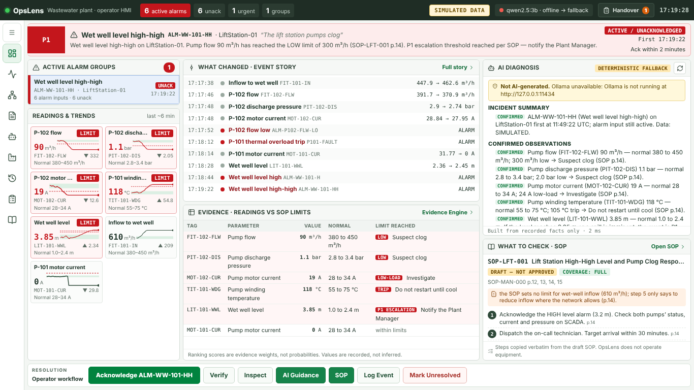

# OpsLens — Edge-Native Contextual AI Copilot for Industrial HMIs

> **Team Sentient Screens** · Winner, Schneider Electric HMI Hackathon (Innovation Marathon), SRM Institute of Science and Technology, 10 September 2026 · Problem statement **PS1 — AI-Powered Runtime Copilot for Industrial HMI**.
>
> OpsLens is a student prototype. It is not a Schneider Electric product and is not deployed at any plant.

An HMI tells the operator *that* an alarm is active. OpsLens reconstructs **the story behind the alarm**: which readings moved first, which equipment is involved, what the plant's SOP says the limits are, how far the process is from the next escalation, which procedure applies, and how the operator will know the problem is fixed — with every number calculated in Python and every procedure step copied verbatim from the cited SOP page.

It is **advisory and read-only**. It never starts or stops a motor, changes a speed, opens a valve, writes a PLC variable or overrides an interlock.

---

## What you see in the demo

The Engineering Console's **Scenario Lab** runs the six incidents from the plant incident map, with their exact values (normal → alarm/limit → during incident → after fix):

| # | Incident | Equipment · primary alarm | Procedure (SOP-MAN-000 Rev 0, **draft — not approved**) | Coverage |
|---|---|---|---|---|
| 1 | Rags jam the bar screen | InletWorks-01 · `ALM-SCR-110-DL` | SOP-INL-001 Bar Screen Blockage Response | full (gap: no screenings range) |
| 2 | The lift station pumps clog | LiftStation-01 · `ALM-WW-101-HH` | SOP-LFT-001 Lift Station High-High Level and Pump Clog Response | full (gap: no inflow limit) |
| 3 | Nocardia foam on the aeration tank | AerationBasin-01 · `ALM-AER-201-FOAM` | SOP-BIO-001 Activated Sludge Foam Control | full (TSS limits sit in BIO-002) |
| 4 | RAS pump fails, sludge blanket rises | RASSystem-01 · `ALM-SLB-201-HIGH` | SOP-BIO-002 RAS Pump Failure and Sludge Blanket Control | full |
| 5 | CHP engine trips, gas holder fills | BiogasSystem-01 · `ALM-GAS-601-HIGH` | SOP-GAS-001 Biogas Holder High Pressure, CHP Trip and Flare | full (gap: no CHP engine diagnosis) |
| 6 | Centrate poisons the plant inlet | DewateringCentrifuge-01 · `ALM-SLD-701-CAPTURE` | SOP-SLD-001 Dewatering Centrifuge and Centrate Recycle | **partial** — covers centrate as an ammonia load only; nothing on inhibitory/toxic centrate or nitrification inhibition |

The **Operator HMI** (designed for a 1366×768 panel, no page scroll) answers, on one screen: *what alarm* (banner: severity, alarm, equipment, state, acknowledgement deadline) · *what changed* (Event Story, trends with normal band and SOP limit lines) · *evidence* (readings vs SOP limits with page numbers) · *possible cause* (AI diagnosis) · *what to check* (verbatim draft-SOP steps and coverage gaps). Data is always labelled **SIMULATED** or **LIVE PLC**.

**AI diagnosis**: Qwen (`qwen2.5:3b` via local Ollama) explains the Evidence Engine's facts in seven sections — summary · confirmed observations · possible causes · evidence for/against · missing information · safe operator checks · engineering assessment — labelled CONFIRMED / HYPOTHESIS / UNKNOWN. It streams; every answer is checked against the incident record (tags, numbers, SOP steps). If Ollama is unavailable or the answer fails the check, a deterministic diagnosis is shown, labelled **"DETERMINISTIC FALLBACK — not AI-generated"**.

| Endpoint | Purpose |
|---|---|
| `GET /api/events/{id}/diagnosis/stream` | SSE: `meta`, `token` (draft), `done` (validated result, latency) |
| `GET /api/events/{id}/brief` | Deterministic operator brief (no LLM) |
| `GET /api/events/{id}/trends` | Incident's own tags with normal band and SOP limits |
| `GET /api/plant/overview` | Monitoring view of all plant tags (not an incident) |
| `GET /api/copilot/ollama` | Ollama reachability, model, `verified_in_this_process`, `last_diagnosis_call` |
| `POST /api/scenarios/run` · `/stop` · `/corrective-action` | Start, stop, simulate the fix (after-fix values) |



*Captured in a container without Ollama, so the diagnosis shows the labelled deterministic fallback; with Ollama running the panel shows the streamed Qwen answer.*

OpsLens is read-only: it never writes to a PLC, operates pumps/valves/motors, or acknowledges/clears alarms by itself. Evidence ranking scores are not probabilities.

---

## Quick start on Windows (your original laptop)

**Requirements:** Python 3.10+ (3.11 recommended), Node.js 18+ LTS. Optional: Ollama with `qwen2.5:3b`, Docker (for Qdrant).

1. Copy the whole `opslens` folder to the laptop (do **not** copy any `.venv` or `node_modules` from another machine — the scripts create them).
2. Double-click **`setup_windows.bat`** (first time only). It creates `edge_intelligence\.venv`, installs Python packages (falls back to `requirements-core.txt` if PyTorch cannot install), runs `npm ci` in `hmi_ui`, and copies `.env.example` to `.env`.
3. Optional — local AI. In a terminal:
   ```bat
   E:\Ollamma\App\ollama.exe serve
   E:\Ollamma\App\ollama.exe pull qwen2.5:3b
   ```
   (`OLLAMA_MODELS=E:\Ollamma\Models` if your models live there.) Without Ollama, OpsLens still runs and says *AI: DETERMINISTIC* / *OFFLINE*.
4. Double-click **`start_all.bat`**. It starts the backend (port 8001), waits for `/api/health`, starts both frontends and opens:
   - Operator HMI — http://localhost:5173
   - Engineering console (Scenario Lab, Procedures, Alarm Reference, Metrics) — http://localhost:5174
5. In the console choose **Lift Station — Wet-Well High-High Level** and press **START SCENARIO**. Switch to the HMI.

Individual launchers: `start_backend.bat`, `start_frontend.bat`. Tests: `run_tests.bat`.

### Manual commands (any OS)

```bat
cd edge_intelligence
py -3 -m venv .venv
.venv\Scripts\python -m pip install -r requirements.txt   :: or requirements-core.txt
copy .env.example .env
.venv\Scripts\python server.py                              :: http://127.0.0.1:8001

cd ..\hmi_ui
npm ci
npm run dev            :: Operator HMI  http://localhost:5173
npm run dev:console    :: Console       http://localhost:5174
```

---

## Configuration (`edge_intelligence/.env`)

| Setting | Default | Purpose |
|---|---|---|
| `OPSLENS_PORT` | `8001` | Backend port (frontends proxy to 8001) |
| `OPSLENS_LLM_PROVIDER` | `ollama` in `.env.example`; `none` if unset | `ollama`, `groq`, `none`, … |
| `EDGE_LLM_URL` / `EDGE_LLM_MODEL` | `http://localhost:11434` / `qwen2.5:3b` | Local Ollama |
| `OPSLENS_OLLAMA_TIMEOUT` | `60` s | Read timeout for a local model (was a fixed 4 s, which always timed out on CPU) |
| `OPSLENS_OLLAMA_KEEP_ALIVE` | `30m` | Keeps the model loaded between questions |
| `GROQ_API_KEY` | — | Optional cloud fallback (`OPSLENS_LLM_PROVIDER=groq`) |
| `QDRANT_URL` | `http://localhost:6333` | Optional. Without Qdrant or sentence-transformers, BM25 keyword retrieval is used and reported |
| `OPSLENS_SHIFT_NAME/START/END` | `Night 18:00–06:00` | Shift window for handover |
| `PLC_OPCUA_*` | disabled | Read-only OPC UA client — see [PLC_OPCUA_SETUP.md](PLC_OPCUA_SETUP.md) |
| `OPSLENS_DB_PATH` | `edge_intelligence/opslens.db` | Move the SQLite file elsewhere |

Never put API keys in the frontend or commit `.env`.

---

## Documentation

| File | Contents |
|---|---|
| [ARCHITECTURE.md](ARCHITECTURE.md) | Components, data flow, what is implemented vs. planned |
| [ALARM_CONFIGURATION.md](ALARM_CONFIGURATION.md) | Alarms extracted from the SOP PDF with page references; conflicts with the registry; lifecycle states |
| [PLC_OPCUA_SETUP.md](PLC_OPCUA_SETUP.md) | Connecting the read-only OPC UA adapter to the lab's M241/M251 PLC |
| [TROUBLESHOOTING.md](TROUBLESHOOTING.md) | Ports, Ollama, Qdrant, "temporarily unavailable", 409, etc. |
| [CHANGELOG.md](CHANGELOG.md) | Bugs found, bugs fixed, schema/migration notes |
| [TEST_REPORT.md](TEST_REPORT.md) | What was tested, results, and what still needs the real laptop / lab |
| [docs/DEMO_SCRIPT.md](docs/DEMO_SCRIPT.md) | 3-minute demo talk track for interviews |
| [PROJECT_WALKTHROUGH.md](PROJECT_WALKTHROUGH.md) | Original study guide (pre-v2) |

## Repository layout

```text
opslens/
├── edge_intelligence/          FastAPI backend (Python)            ← active
│   ├── config/alarm_reference.json   alarms from SOP-MAN-000, page-cited
│   ├── alarm_config.py               tag classification, SOP limit checks, conflicts
│   ├── operator_brief.py             deterministic 8-part brief
│   ├── sop_steps.py                  verbatim numbered steps from the PDF
│   ├── api/routes.py, api/copilot_routes.py
│   ├── sop_documents/ingested_pdfs/  SOP-MAN-000 (the plant SOP manual PDF)
│   └── tests/                        348 automated tests
├── hmi_ui/                     React + Vite operator HMI (5173) and console (5174)   ← active
├── setup_windows.bat · start_all.bat · start_backend.bat · start_frontend.bat · run_tests.bat
├── docker-compose.yml          optional Qdrant
├── ops-lens/, opslens-generator/   earlier hackathon iterations (not used by the scripts)
└── docs/previous/              README from before this update
```

## License

MIT
