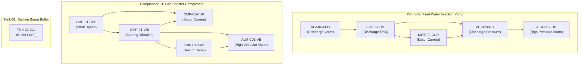

# OpsLens Scenario Ground-Truth Specification

This document provides the definitive ground-truth contract for validating all downstream OpsLens analytics engines (Prioritization, Topology Correlation, Event Timeline, Evidence Engine, and SOP Retrieval).

---

## 1. Plant Topology DAG

---

## 2. Master Tag Registry Baselines

| Tag | Equipment | Description | Unit | Type | Baseline Min | Baseline Max | Trip Limit | Severity | Upstream Topology |
|---|---|---|---|---|---|---|---|---|---|
| `VLV-04-POS` | Pump-02 | Discharge Valve Position | `%` | float | 70.0 | 85.0 | *None* | 0.60 | `[]` |
| `FIT-02-FLW` | Pump-02 | Discharge Flow Rate | `L/min` | float | 75.0 | 90.0 | 50.0 (Low) | 0.75 | `["VLV-04-POS"]` |
| `MOT-02-CUR` | Pump-02 | Drive Motor Current | `A` | float | 7.0 | 8.2 | 9.5 (High) | 0.80 | `["FIT-02-FLW"]` |
| `PIT-02-PRS` | Pump-02 | Discharge Line Pressure | `bar` | float | 4.2 | 5.2 | 6.5 (High) | 0.90 | `["FIT-02-FLW", "MOT-02-CUR"]` |
| `ALM-P02-HP` | Pump-02 | High Pressure Trip Alarm | `status` | bool | 0.0 | 0.0 | 1.0 (True) | 1.00 | `["PIT-02-PRS"]` |
| `CMP-01-SPD` | Compressor-01 | Compressor Shaft Speed | `RPM` | float | 2920.0 | 3020.0 | 3300.0 | 0.65 | `[]` |
| `CMP-01-VIB` | Compressor-01 | Drive End Bearing Vibration | `mm/s` | float | 1.2 | 2.8 | 7.0 (High) | 0.85 | `["CMP-01-SPD"]` |
| `CMP-01-CUR` | Compressor-01 | Motor Stator Current | `A` | float | 46.0 | 52.0 | 64.0 (High) | 0.80 | `["CMP-01-SPD", "CMP-01-VIB"]` |
| `CMP-01-TMP` | Compressor-01 | Drive Bearing Temperature | `°C` | float | 58.0 | 68.0 | 85.0 (High) | 0.85 | `["CMP-01-VIB"]` |
| `ALM-C01-VB` | Compressor-01 | High Vibration Trip Alarm | `status` | bool | 0.0 | 0.0 | 1.0 (True) | 1.00 | `["CMP-01-VIB", "CMP-01-TMP"]` |
| `TNK-01-LVL` | Tank-01 | Buffer Tank Level | `%` | float | 55.0 | 65.0 | 88.0 (High) | 0.50 | `[]` |

---

## 3. Incident Archetypes Ground Truth

### Archetype A: Valve Restriction Cascade
- **Scenario ID**: `valve_restriction_cascade` (or `valve_restriction`)
- **Target Equipment**: `Pump-02`
- **Total Duration**: 75 seconds
- **Mechanism**: Throttling valve unexpectedly drifts closed, restricting discharge line volume, which drops downstream flow, increases motor head resistance, spikes line pressure, and triggers a high-pressure trip alarm.

#### Ground Truth Matrix
| Tag | Nominal | Incident Value | Delta % | Direction | Precedes Primary Alarm | Topology Distance to Alarm | Should Correlate? |
|---|---|---|---|---|---|---|---|
| `VLV-04-POS` | 78.0% | 43.0% | **-44.9%** | down | Yes (t+10s) | 3 | **YES (Root Cause)** |
| `FIT-02-FLW` | 82.0 L/min | 56.0 L/min | **-31.7%** | down | Yes (t+18s) | 2 | **YES** |
| `MOT-02-CUR` | 7.8 A | 9.2 A | **+17.9%** | up | Yes (t+28s) | 2 | **YES** |
| `PIT-02-PRS` | 4.8 bar | 6.9 bar | **+43.8%** | up | Yes (t+36s) | 1 | **YES** |
| `ALM-P02-HP` | False | True | **Tripped** | up | N/A (Primary Alarm at t+52s) | 0 | **YES (Primary)** |
| *All Compressor tags* | Nominal | Nominal | ~0% | stable | No | Unreachable | **NO** |
| `TNK-01-LVL` | Nominal | Nominal | ~0% | stable | No | Unreachable | **NO** |

---

### Archetype B: Bearing Wear Degradation
- **Scenario ID**: `bearing_wear`
- **Target Equipment**: `Compressor-01`
- **Total Duration**: 80 seconds
- **Mechanism**: Progressive mechanical fatigue of compressor drive-end bearing. High-frequency friction drives mechanical vibration past ISO trip limit, increasing motor stator load and bearing casing heat.
- **Acceptance Criterion**: Pump-02 tags are on a separate physical unit and **MUST NOT** appear in the correlation graph.

#### Ground Truth Matrix
| Tag | Nominal | Incident Value | Delta % | Direction | Precedes Primary Alarm | Topology Distance to Alarm | Should Correlate? |
|---|---|---|---|---|---|---|---|
| `CMP-01-VIB` | 2.0 mm/s | 7.8 mm/s | **+290.0%** | up | Yes (t+15s) | 1 | **YES (Root Cause)** |
| `CMP-01-CUR` | 49.0 A | 58.5 A | **+19.4%** | up | Yes (t+25s) | 2 | **YES** |
| `CMP-01-TMP` | 63.0 °C | 86.5 °C | **+37.3%** | up | Yes (t+30s) | 1 | **YES** |
| `ALM-C01-VB` | False | True | **Tripped** | up | N/A (Primary Alarm at t+50s) | 0 | **YES (Primary)** |
| *All Pump-02 tags* | Nominal | Nominal | ~0% | stable | No | Unreachable | **STRICTLY NO** |
| `TNK-01-LVL` | Nominal | Nominal | ~0% | stable | No | Unreachable | **NO** |

---

### Archetype C: Mechanical Seal Leak
- **Scenario ID**: `seal_leak`
- **Target Equipment**: `Pump-02`
- **Total Duration**: 60 seconds
- **Mechanism**: Pump mechanical face seal failure causes loss of fluid boundary. Discharge line pressure and discharge flow **drop simultaneously**. Hydraulic head resistance drops, causing motor current to decrease slightly.
- **Differentiating Signature**: Unlike Archetype A where flow drops but pressure surges, here flow **and** pressure drop together while `VLV-04-POS` stays at nominal position (~78%).

#### Ground Truth Matrix
| Tag | Nominal | Incident Value | Delta % | Direction | Topology Distance | Should Correlate? |
|---|---|---|---|---|---|---|
| `FIT-02-FLW` | 82.0 L/min | 45.0 L/min | **-45.1%** | down | 1 | **YES** |
| `PIT-02-PRS` | 4.8 bar | 2.1 bar | **-56.2%** | down | 1 | **YES** |
| `MOT-02-CUR` | 7.8 A | 7.1 A | **-9.0%** | down | 2 | **YES** |
| `VLV-04-POS` | 78.0% | 78.0% | ~0% | stable | 2 | **NO (Valve did not cause leak)** |
| `ALM-P02-HP` | False | False | 0% | stable | 0 | **NO (Underpressure, not overpressure)** |
| *All Compressor tags* | Nominal | Nominal | ~0% | stable | Unreachable | **NO** |

---

### Archetype D: Sensor Fault / False Positive Spike
- **Scenario ID**: `sensor_fault`
- **Target Equipment**: `Pump-02`
- **Total Duration**: 40 seconds
- **Mechanism**: Pressure transmitter transient electrical glitch or analog card fault causes `PIT-02-PRS` to abruptly spike to 7.35 bar for 12 seconds and then return to baseline.
- **Acceptance Criterion**: Zero physical support across upstream tags (`FIT-02-FLW`, `MOT-02-CUR`, `VLV-04-POS`). The downstream correlation engine **must reject** this event and **must NOT** build an EventStory timeline.

#### Ground Truth Matrix
| Tag | Nominal | Incident Value | Delta % | Direction | Upstream Physically Deviated? | Should Correlate? |
|---|---|---|---|---|---|---|
| `PIT-02-PRS` | 4.8 bar | 7.35 bar (Spike) | **+53.1%** | up | **NO** | **YES (Isolated Anomaly)** |
| `VLV-04-POS` | 78.0% | 78.0% (Nominal) | ~0% | stable | No | **STRICTLY NO** |
| `FIT-02-FLW` | 82.0 L/min | 82.0 L/min (Nominal) | ~0% | stable | No | **STRICTLY NO** |
| `MOT-02-CUR` | 7.8 A | 7.8 A (Nominal) | ~0% | stable | No | **STRICTLY NO** |
| `ALM-P02-HP` | False | False | 0% | stable | No | **STRICTLY NO** |
| *All other plant tags* | Nominal | Nominal | ~0% | stable | No | **STRICTLY NO** |

---

## 4. Acceptance Criteria Validation Guide for Downstream Engines

1. **Correlation Engine Rule**:
   - For an event triggered by tag $T$, query all reachable upstream tags in the DAG.
   - A tag $U \in \text{upstream}(T)$ is correlated **if and only if** $|U(t) - U_{\text{baseline}}| > \epsilon$ prior to or coincident with $T$'s trigger.
   - For Scenario D: `upstream(PIT-02-PRS) = [FIT-02-FLW, MOT-02-CUR, VLV-04-POS]`. All deviations are within nominal noise ($< 5\%$). Thus $\text{correlated\_tags} = \emptyset$. Event marked as `FALSE_POSITIVE_SENSOR_SPIKE`.
2. **Equipment Isolation Rule**:
   - For Scenario B: Compressor tags deviate, but $\text{topology\_upstream}$ links do not connect Compressor-01 to Pump-02. Downstream correlation graph **must contain 0 Pump-02 tags**.
3. **Continuous Timeline Rule**:
   - When scenarios run sequentially without process restart, row timestamps in SQLite table `tag_readings` must be strictly monotonically non-decreasing.
